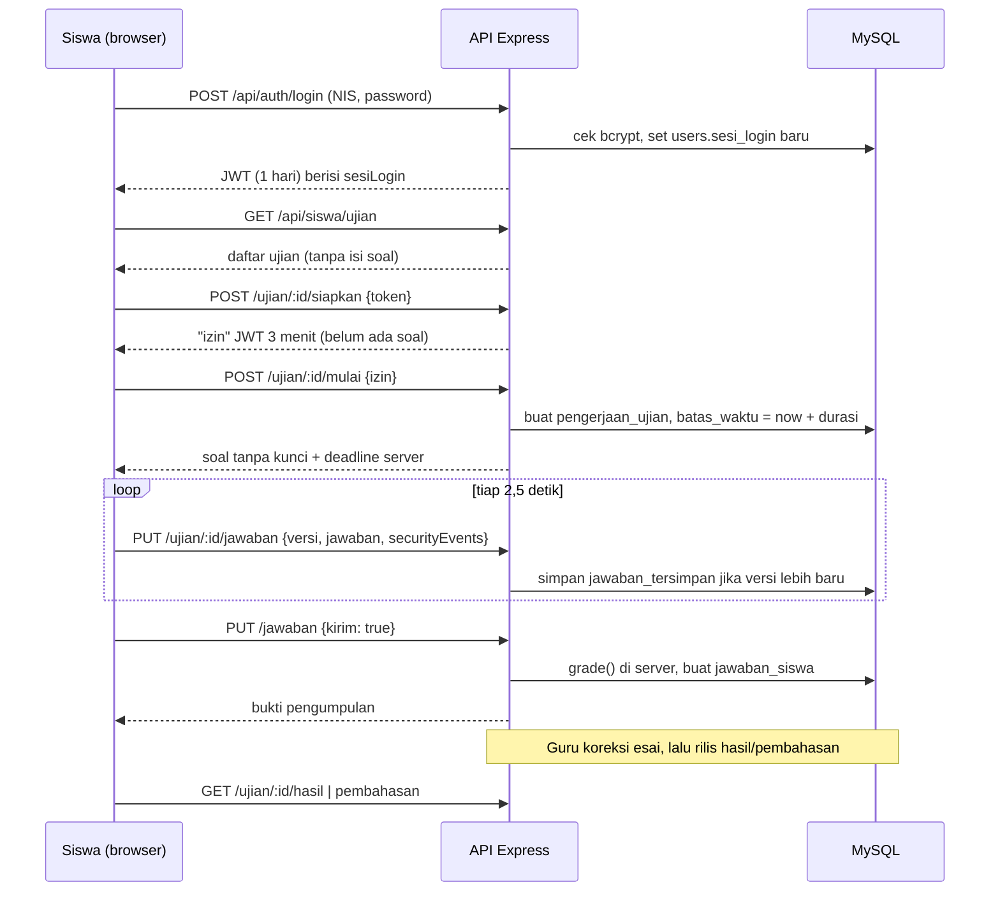

# Audit Aplikasi CBT "Web Ujian"

Tanggal audit: 11 November 2026. Metode: pembacaan kode statis seluruh backend (±3.700 baris) dan bagian frontend yang menyangkut login, pengerjaan ujian, dan pengamanan. Aplikasi **tidak dijalankan**, test **tidak dieksekusi**, dan tidak ada uji beban; semua klaim performa adalah analisis kode dan ditandai "perlu verifikasi".

Konteks yang Anda kirim masih berupa placeholder (`[contoh: ...]`), jadi konteks berikut saya simpulkan dari kode: Node.js + Express + Prisma (MySQL/MariaDB), frontend React + Vite, satu sekolah (SMP/SMA Islam Plus Baitussalam), dijalankan di LAN pada port 5000. Asumsi saya ditandai **[Asumsi]**, sisanya fakta dari kode.

> **Status perbaikan (11 November 2026).** Sudah diperbaiki di kode: K-01 (wajib ganti password bawaan), K-02 (rate limit), K-03 (validasi secret, sesi semua peran, logout server), K-05 (heartbeat dan autosave ringan), K-06 (`xlsx` 0.20.3), K-08 (pembahasan saat remedial), K-09 (header keamanan, CORS), K-10 untuk mapel, K-12, K-13. K-04 diselesaikan lewat Caddy saat deploy. Tahap 1 (sisa K-10, K-14, K-15, K-16) sudah diperbaiki di kode. Tahap 2 dikerjakan bertahap: (1) migrasi Prisma **selesai di kode** — folder `backend/prisma/migrations` (`0_awal` + `20261111000000_tahap2`: enum `role`, unique `(ujian_id, siswa_id)` di `jawaban_siswa`, FK `pelaku_id` dan `percobaan_token`, kolom `acak_soal`/`acak_opsi`/`urutan`, tabel `audit_log`), diuji di MySQL lokal dan berhasil diterapkan di VPS untuk SMP dan SMA pada 11 November 2026; (2) pengacakan soal dan opsi per pengerjaan (K-07) **selesai di kode** — `backend/src/routes/examOrder.ts`, pilihan "Acak urutan soal/opsi" di aturan draf, ujian yang sudah terbit tetap urutan asli; (3) audit log (K-11) **selesai di kode** — `backend/src/middleware/audit.ts` mencatat login berhasil/gagal, keluar, ganti password, dan semua permintaan pengubah data di `/api/admin` dan `/api/guru` beserta IP dan user agent (disimpan 180 hari), ditampilkan di menu admin **Log Audit**; (4) gambar soal ke file statis **selesai di kode** — unggahan disimpan di `UPLOAD_DIR/soal/<sha256>.<ext>` dan disajikan di `/media` dengan cache setahun (`backend/src/routes/questionImages.ts`); gambar lama dipindahkan dengan `npm run db:gambar`; (5) uji beban: skrip dan panduan **selesai** (`docs/uji-beban.md`); percobaan lokal 500 siswa lulus setelah dua deadlock (mulai dan kumpul bersamaan) diperbaiki, tetapi **uji di server sekolah belum dijalankan**. Nomor baris pada temuan di bawah merujuk ke kode sebelum perbaikan.

> **Deploy tahap 2 (11 November 2026, sekitar 13.06 WIB).** Rilis aktif di `cbt@smp` dan `cbt@sma`. Migrasi diuji pada salinan kedua database sebelum dipasang; skema produksi sesuai dengan Prisma sesudahnya. Skrip gambar memeriksa 15 soal SMP dan 50 soal SMA tanpa menemukan gambar base64 yang perlu dipindahkan. Cadangan sebelum migrasi: `/var/backups/cbt/pre-tahap2-20261111T060523Z`. Uji beban di VPS belum dijalankan.

---

## Executive Summary

1. Aplikasi ini adalah CBT satu sekolah dengan tiga peran (admin, guru, siswa), lima tipe soal, sesi susulan, remedial, koreksi esai, analisis butir soal, dan mode offline-toleran berbasis IndexedDB.
2. Fondasi integritas ujiannya **baik**: kunci jawaban tidak dikirim ke siswa, timer dan penilaian dihitung server, jawaban divalidasi dan diberi versi, akses data dibatasi per peran dan per penugasan. Saya tidak menemukan SQL injection, IDOR, atau XSS yang dapat dieksploitasi.
3. **Risiko 1 (Critical):** password bawaan = NIS/NIP dan tidak ada paksaan ganti. Siswa yang tahu NIP guru dapat login sebagai guru dan melihat semua kunci jawaban; siswa yang tahu NIS temannya dapat mengumpulkan ujian teman itu.
4. **Risiko 2 (High):** pembatas percobaan login dapat dilewati dengan header `X-Forwarded-For` karena `trust proxy` aktif padahal server diakses langsung.
5. **Risiko 3 (High):** `JWT_SECRET` contoh di `.env.example` tidak ditolak saat startup; bila dipakai apa adanya, token admin dapat dipalsukan. Token admin/guru juga tidak bisa dicabut sampai mereka ganti password.
6. **Risiko 4 (High):** tidak ada HTTPS bawaan; password dan token lewat jaringan Wi-Fi sekolah dalam bentuk teks biasa.
7. **Risiko 5 (High, ketahanan):** setiap siswa mengirim heartbeat tiap 2,5 detik, dan tiap heartbeat menjalankan transaksi yang memuat seluruh soal (termasuk gambar base64). Pada 500 peserta ini ±200 transaksi/detik; kemungkinan besar pool koneksi Prisma habis. Perlu uji beban sebelum dipakai serentak.
8. Anti-kecurangan hanya di sisi browser (fullscreen, deteksi pindah tab) dan belum ada pengacakan soal/opsi.
9. Belum ada: bank soal lintas ujian, menjodohkan, audio/video, ekspor PDF, kartu peserta, multi-sekolah, PWA, audit log admin, backup, CI.
10. Skor keamanan keseluruhan: **60/100**. Tiga perbaikan cepat (paksa ganti password, perbaiki rate limit, validasi secret + HTTPS) menaikkannya ke kisaran 80.

---

## Bagian 1: Ringkasan & Arsitektur

### Tujuan dan teknologi

| Lapisan | Teknologi | Sumber |
|---|---|---|
| Backend | Node.js, Express 4.22, TypeScript, Prisma 6.19 | `backend/package.json` |
| Database | MySQL/MariaDB | `backend/prisma/schema.prisma:1-4` |
| Auth | JWT HS256 (`jsonwebtoken` 9), bcrypt cost 10 | `backend/src/middleware/auth.ts`, `controllers/authController.ts` |
| Excel | `exceljs` 4.4 (tulis), `xlsx` 0.18.5 (baca) | `controllers/adminImportController.ts`, `routes/questionWorkbook.ts` |
| Frontend | React 18, Vite 6, Tailwind 3, axios, KaTeX | `frontend/package.json` |
| Deploy | Satu proses Node menyajikan API + build frontend di port 5000 | `backend/src/server.ts:44-56` |

### Struktur folder

| Lokasi | Peran |
|---|---|
| `backend/src/server.ts` | Bootstrap Express, mount rute, antrean latar tiap 3 detik |
| `backend/src/middleware/` | `auth.ts` (verifikasi JWT + sesi), `upload.ts` (multer, Excel 5 MB di RAM) |
| `backend/src/controllers/` | Admin: CRUD kelas/siswa/guru/mapel, impor akun, monitoring, navbar |
| `backend/src/routes/guruRoutes.ts` | Seluruh alur guru: draf, soal, terbit, sesi, susulan, koreksi, rilis, remedial, rekap (1.144 baris) |
| `backend/src/routes/studentExamRoutes.ts` | Daftar ujian siswa, verifikasi token, mulai, autosave, submit |
| `backend/src/routes/studentResultsRoutes.ts` | Notifikasi, bukti kirim, hasil, pembahasan |
| `backend/src/routes/exam*.ts`, `questionAnalytics.ts` | Logika murni: penilaian, poin, keamanan, profil ujian, analisis butir |
| `backend/prisma/` | Skema dan seed admin |
| `backend/tests/` | 19 file test (`node --test` via tsx) |
| `frontend/src/pages/{admin,guru,siswa}` | Halaman per peran; navigasi berbasis state di `App.tsx` (tanpa router) |
| `docs/` | Catatan keamanan ujian dan sistem UI |
| `outputs/` | Dua contoh file soal Excel |

### Alur utama



### Skema database

Tabel utama (`backend/prisma/schema.prisma`): `users`, `kelas`, `mapel`, `guru_mapel_kelas` (penugasan, unik per mapel+kelas), `jenis_ujian`, `ujian` (+ relasi many-to-many `kelasTujuan` dan `pesertaRemedial`), `soal`, `pengerjaan_ujian` (attempt, unik per ujian+siswa), `jawaban_siswa` (hasil final), `sesi_susulan`, `peserta_susulan`, `kegiatan_ujian` (log + antrean), `notifikasi_ujian`, `percobaan_token`, `navbar_settings`.

Penilaian kualitas:

- **Baik:** foreign key dan index ada pada jalur utama; `pengerjaan_ujian` punya `@@unique([ujianId, siswaId])`; FK komposit sesi susulan (baris 203) mencegah attempt menunjuk sesi ujian lain; bobot memakai `Decimal`.
- **Kurang:**
  - Isi soal, opsi, kunci, dan gambar base64 disimpan dalam satu kolom JSON `soal.isi` (baris 126). Jawaban siswa juga satu JSON per ujian (`detail_jawaban`). Sederhana, tetapi analisis per butir harus dihitung di aplikasi dan setiap pembacaan soal ikut menarik gambar.
  - `jawaban_siswa` tidak punya unique `(ujian_id, siswa_id)` (baris 154 hanya index); kode mengandalkan lock transaksi dan "ambil yang terbaru".
  - `kegiatan_ujian.pelaku_id` dan `percobaan_token` tanpa foreign key (baris 213, 242-250); data yatim tertinggal saat user/ujian dihapus.
  - `users.role` berupa string bebas, bukan enum; tidak ada kolom `created_at`/`updated_at`.
  - Kolom lama `soal.pilihan_opsi` dan `kunci_jawaban` masih ada tetapi tidak dipakai penilaian.
  - `ujian.kelas_id` dan `kelasTujuan` menyimpan informasi yang tumpang tindih (`routes/examClasses.ts:3-6`).
  - Tidak ada folder migrasi; skema diterapkan dengan `prisma db push` (README), berisiko untuk database produksi.

---

## Bagian 2: Analisis Fitur

| Fitur | Status | Lokasi | Catatan kualitas |
|---|---|---|---|
| **a.** Peran admin/guru/siswa | Ada | `middleware/auth.ts`, `adminRoutes.ts:43`, `guruRoutes.ts:21-24`, `studentExamRoutes.ts:53-60` | Tiga peran tetap, tanpa permission granular. Tidak ada peran proktor terpisah. Guru dibatasi penugasan mapel+kelas (`examScope`, `guruRoutes.ts:34-48`). |
| a. CRUD + reset password | Ada | `controllers/adminController.ts` | Reset mengembalikan password ke NIS/NIP (baris 582). |
| **b.** PG, PG kompleks, benar/salah, isian, esai | Ada | `guruRoutes.ts:267-308`, `examGrading.ts` | Validasi server rapi. Isian mendukung beberapa jawaban dan mode angka. |
| b. Menjodohkan | Tidak ada | n/a | |
| b. Gambar | Ada | `guruRoutes.ts:273-284` | Base64 ≤700 KB di dalam JSON, atau URL http/https eksternal. |
| b. Audio/video | Tidak ada | n/a | |
| b. Rumus matematika | Ada | `frontend/src/pages/guru/FormulaText.tsx` | KaTeX inline `$...$`, `trust: false`. |
| b. Bank soal lintas ujian | Tidak ada | n/a | Soal melekat pada satu ujian; penggunaan ulang hanya lewat duplikat ujian (`guruRoutes.ts:219`). |
| **c.** Acak soal/opsi | Tidak ada | `studentExamRoutes.ts:19` | Urutan selalu `id asc`. Diakui di `docs/keamanan-ujian.md`. |
| **d.** Jadwal, durasi | Ada | `guruRoutes.ts:118-127, 230-255` | Jadwal terkunci setelah ada peserta mulai. |
| d. Token | Ada | `guruRoutes.ts:463-466, 604-632`; `studentExamRoutes.ts:182-195` | 6 karakter acak kriptografis, bisa diganti; 5 salah = jeda 1 menit. Satu token per sesi, bukan per siswa. |
| d. KKM | Ada | `guruRoutes.ts:821-841` | |
| d. Jumlah percobaan | Parsial | `schema.prisma:205` | Selalu satu kali; pengulangan hanya lewat reset oleh guru (`guruRoutes.ts:634-653`). |
| **e.** Timer server-side | Ada | `studentExamRoutes.ts:47-49, 176-179, 256-262` | Deadline per siswa, dibatasi akhir sesi. |
| e. Autosave | Ada | `KerjakanUjian.tsx:50-113`, `attemptStore.ts` | IndexedDB + sinkron tiap 2,5 detik dengan nomor versi. |
| e. Navigasi, ragu-ragu | Ada | `KerjakanUjian.tsx:131-135, 175-192` | Ragu-ragu hanya tersimpan di perangkat. |
| e. Lanjut saat putus koneksi | Ada | `BerandaSiswa.tsx:119-125`, `studentExamRoutes.ts:256-262` | Kiriman ≤5 menit setelah deadline masuk tinjauan guru. |
| **f.** Penilaian otomatis | Ada | `examGrading.ts:22-76` | Tanpa nilai parsial untuk PG kompleks/BS. |
| f. Koreksi esai manual | Ada | `guruRoutes.ts:940-985` | Dengan catatan dan log perubahan. |
| f. Remedial | Ada | `guruRoutes.ts:843-871` | Menyalin soal ujian asal untuk siswa di bawah KKM. |
| f. Perbaikan kunci pasca-ujian | Ada | `guruRoutes.ts:1091-1142`, `examGrading.ts:78-118` | Pratinjau dampak, antrean penilaian ulang. |
| f. Analisis butir | Ada | `questionAnalytics.ts`, `guruRoutes.ts:664-710` | KR-20, daya pembeda (korelasi butir-sisa), distraktor; minimal 10 kiriman. |
| **g.** Ekspor Excel rekap | Ada | `guruRoutes.ts:919-938` | Satu sheet per ujian. |
| g. Ekspor PDF, kartu peserta | Tidak ada | n/a | |
| **h.** Impor siswa/guru Excel | Ada | `adminImportController.ts:146-224` | Ringkasan baris gagal; duplikat dilewati. |
| h. Impor soal Excel | Ada | `questionWorkbook.ts`, `guruRoutes.ts:382-430` | Dua format template, ada mode pratinjau. Tanpa gambar. |
| h. Impor Word/format lain | Tidak ada | n/a | |
| **i.** Monitoring | Parsial | `monitoringController.ts`, `ExamSessions.tsx:62-67` | Polling 15 detik, bukan push. Monitoring admin memuat semua ujian tanpa paginasi. |
| **j.** Kelas, mapel, penugasan | Ada | `adminController.ts` | |
| j. Multi-sekolah | Tidak ada | `adminImportController.ts:38-43` | Nama yayasan/sekolah di-hardcode. |
| **k.** Responsif mobile | Ada | `KerjakanUjian.tsx` | Layout khusus HP, safe-area. |
| k. PWA/offline | Parsial | `attemptStore.ts` | Jawaban bertahan offline, tetapi tanpa service worker/manifest; halaman tidak bisa dimuat ulang saat offline. |
| **l.** Log aktivitas | Parsial | `schema.prisma:210-225` | Hanya kejadian ujian (pelanggaran, reset, koreksi, rilis, jadwal). Login, CRUD akun, reset password tidak dicatat. |

---

## Bagian 3: Analisis Keamanan

### Yang sudah benar (fakta dari kode)

- Password di-hash bcrypt; login memakai hash tiruan agar waktu respons tidak membocorkan keberadaan akun (`authController.ts:11, 60-63`).
- JWT dikunci ke HS256 (`auth.ts:14`); setiap request memeriksa ulang user dan `sesiLogin` di database. Login siswa baru mematikan sesi lama (`authController.ts:76-80`).
- Semua query memakai Prisma atau tagged template `$queryRaw` berparameter. Tidak ada penggabungan string SQL.
- Otorisasi: rute admin di balik `requireAdmin`; semua rute guru memfilter `examScope(actor)`; rute siswa memfilter kelas, susulan, dan remedial (`studentExamRoutes.ts:119-126`); hasil dan bukti selalu difilter `siswaId` dari token.
- Kunci jawaban tidak dikirim saat ujian: `publicQuestions()` hanya meneruskan `teks` dan `gambar` (`studentExamRoutes.ts:33-45`). `/siapkan` tidak mengirim soal.
- Penilaian (`grade`) dan deadline dihitung server. Jawaban divalidasi per tipe (`validatedAnswers`, baris 206-221), setelah deadline ditolak atau ditahan untuk tinjauan.
- Upload hanya ke memori, dibatasi 5 MB, tidak pernah ditulis ke disk, jadi tidak ada path traversal atau eksekusi file.
- Tidak ada `.env`, dump SQL, atau kredensial nyata di repository. Satu-satunya `dangerouslySetInnerHTML` adalah keluaran KaTeX dengan `trust: false`.

### Temuan

| ID | Judul | Severity | File & baris | Risiko | Konsep eksploitasi | Perbaikan |
|---|---|---|---|---|---|---|
| K-01 | Password bawaan = username, tanpa paksaan ganti | **Critical** | `adminController.ts:159, 323, 582`; `adminImportController.ts:207`; `authController.ts:96`; `frontend/src/App.tsx` (dialog dengan tombol "Nanti") | NIS teman sekelas dan NIP guru mudah diketahui. Akun guru membuka semua soal beserta kunci. Akun siswa lain bisa dipakai untuk mengumpulkan ujiannya atau memutus sesinya. | Login memakai NIP guru sebagai username dan password, lalu buka draf ujian. | Lihat contoh 1. |
| K-02 | Rate limit login dapat dilewati | **High** | `server.ts:23`; `authController.ts:47-51` | Kedua kunci pembatas diturunkan dari `req.ip`. Dengan `trust proxy = 1` tanpa reverse proxy, `req.ip` diambil dari header kiriman klien. Pembatas juga hilang saat restart (di memori). | Mengganti nilai `X-Forwarded-For` di tiap percobaan. | Lihat contoh 2. |
| K-03 | Secret JWT contoh tidak ditolak; token admin/guru tak bisa dicabut | **High** | `backend/.env.example:2`; `auth.ts:6, 26`; `authController.ts:76, 84` | Jika `.env` disalin tanpa diubah, secret-nya publik dan token admin bisa dipalsukan. `sesiLogin` admin/guru kosong sampai ganti password, sehingga token curian berlaku 24 jam dan logout hanya menghapus di browser. | Menandatangani token `{id: <admin>}` dengan secret contoh. | Lihat contoh 3. |
| K-04 | Tidak ada HTTPS; token di `localStorage` | **High** | `server.ts:76`; `frontend/src/services/api.ts:16`; `Login.tsx:20` | Password dan JWT terkirim polos di Wi-Fi sekolah. Wake Lock juga tidak aktif tanpa secure context. | Menyadap trafik di jaringan yang sama. | Pasang Caddy/Nginx dengan TLS di depan port 5000 (sertifikat internal untuk LAN), bind Node ke `127.0.0.1`. Jangka menengah: pindahkan token ke cookie `HttpOnly; Secure; SameSite=Strict` + proteksi CSRF. |
| K-05 | Heartbeat berat berisiko melumpuhkan server saat ujian serentak | **High** (ketersediaan) | `KerjakanUjian.tsx:97`; `studentExamRoutes.ts:16-22, 109-132`; `examSecurity.ts:40-42` | Lihat bagian F. Gangguan saat ujian berlangsung berdampak ke semua peserta. | Tidak perlu penyerang; beban normal 500 peserta. | Lihat contoh 4. |
| K-06 | `xlsx` 0.18.5 rentan | Medium | `backend/package.json:19`; `adminImportController.ts:152`; `questionWorkbook.ts:195` | Versi npm ini terkena CVE-2023-30533 (prototype pollution) dan CVE-2024-22363 (ReDoS). Pemicunya file Excel dari guru/admin yang sudah login. | Mengunggah workbook yang dibuat khusus. | Baca juga dengan `exceljs` (sudah terpasang), atau pasang SheetJS ≥0.20.2 dari CDN resminya. |
| K-07 | Anti-kecurangan sepenuhnya di klien; tanpa pengacakan | Medium | `useExamSecurity.ts`; `examSecurity.ts:38-63`; `studentExamRoutes.ts:19` | Server hanya menerima laporan dari browser. Browser yang dimodifikasi cukup tidak melapor. Urutan soal dan opsi identik untuk semua siswa. | Menonaktifkan event listener lewat DevTools/ekstensi. | Acak urutan per attempt dan simpan di `pengerjaan_ujian`; wajibkan Safe Exam Browser untuk ujian berisiko tinggi (Bagian 6). |
| K-08 | Pembahasan ujian asal terbuka saat remedial memakai soal yang sama | Medium | `guruRoutes.ts:129-137, 862`; `studentResultsRoutes.ts:44-71` | Remedial menyalin soal ujian asal. Rute pembahasan mengirim `isi` lengkap dengan kunci dan tidak memeriksa adanya remedial. Jeda serupa ada antara akhir sesi utama dan pembuatan sesi susulan. | Peserta remedial membuka pembahasan ujian asal sebelum remedial. | Tolak pembahasan selama remedial turunannya belum selesai; tolak pembuatan susulan/remedial bila `bahasanRilis` aktif, atau sembunyikan otomatis. |
| K-09 | Tanpa security header; CORS terbuka | Medium | `server.ts:24` | Tidak ada CSP, `X-Frame-Options`, `nosniff`, HSTS. `cors()` mengizinkan semua origin. Dampak CORS terbatas karena auth memakai header Bearer. | Clickjacking; XSS apa pun langsung bisa mengambil token. | Lihat contoh 5. |
| K-10 | Hapus mapel/siswa menghapus ujian dan nilai secara berantai | Medium | `schema.prisma:107-108, 151`; `adminController.ts:234, 485` | `removeMapel` tanpa pemeriksaan; `onDelete: Cascade` ikut menghapus ujian, soal, dan nilai. Menghapus siswa menghapus seluruh nilainya. Tidak ada soft delete atau backup. | Admin salah klik atau akun admin diambil alih. | Ubah relasi ke `Restrict`, tolak hapus bila masih dipakai (seperti `removeKelas`, baris 83-121), tambah arsip/soft delete. |
| K-11 | Audit trail tidak mencakup login dan tindakan admin | Medium | `schema.prisma:210-225`; `adminController.ts` (tanpa pencatatan) | Tidak ada jejak login gagal/berhasil, reset password, CRUD akun, atau penggantian token. IP dan user agent tidak pernah disimpan. | Penyalahgunaan K-01 tidak meninggalkan bukti. | Tabel `audit_log` (pelaku, aksi, target, IP, user agent, waktu) yang diisi dari middleware. |
| K-12 | Pesan error internal dikirim ke klien | Low | `adminController.ts:26, 39, 54, 79, 136, 237, 272, 344, 396, 406, 425, 444, 475, 509, 534, 546` | `error.message` Prisma memuat nama tabel/kolom. Hanya terlihat admin. | Memancing error untuk memetakan skema. | Pakai pola `handle()` di `guruRoutes.ts:50-63`: log di server, pesan generik ke klien. |
| K-13 | Body 8 MB di-parse sebelum autentikasi | Low | `server.ts:29-30` | Permintaan tanpa login tetap menghabiskan memori/CPU untuk parsing. | Membanjiri `/api/guru` dengan body besar. | Jalankan `requireUser` sebelum `express.json`, atau batasi di reverse proxy. |
| K-14 | Gambar soal boleh URL eksternal | Low | `guruRoutes.ts:279-283` | Browser siswa memanggil server luar saat ujian (jejak IP, gambar bisa diganti, gagal di LAN tanpa internet). | Guru menaruh URL yang ia kendalikan. | Hanya izinkan unggahan, atau daftar host yang diizinkan. |
| K-15 | Soal tersisa di IndexedDB perangkat bersama | Low | `attemptStore.ts`; `KerjakanUjian.tsx:70, 85` | Data dihapus saat submit/reset, tetapi tidak saat siswa menutup tab atau logout di tengah ujian. | Siswa berikutnya membuka IndexedDB di komputer lab. | Hapus store saat logout dan saat daftar ujian menyatakan attempt sudah selesai. |
| K-16 | Kebijakan password lemah; admin seed `admin123` | Low | `seed.ts:7`; `authController.ts:107-118` | Hanya panjang minimal 8. Tidak ada reset mandiri. | Menebak password umum. | Paksa ganti saat login pertama (K-01), tolak password umum, buat password admin acak saat seed. |

### Contoh kode perbaikan

**1. K-01: paksa ganti password bawaan.** Tambah kolom `wajibGantiPassword Boolean @default(true)` pada `User`, set `false` di `changePassword`, lalu blok semua rute lain:

```ts
// middleware/auth.ts, setelah res.locals.user = user
if (user.wajibGantiPassword && req.originalUrl !== '/api/auth/password') {
    return res.status(403).json({ code: 'WAJIB_GANTI_PASSWORD', message: 'Ganti password sebelum melanjutkan.' });
}
```

Untuk siswa, alternatif yang lebih praktis di hari ujian: buat password acak 8 karakter saat impor/reset dan cetak di kartu peserta, alih-alih memakai NIS.

**2. K-02: pembatas login yang tidak bisa dipalsukan.**

```ts
// server.ts: hanya percaya proxy bila memang ada
app.set('trust proxy', process.env.TRUST_PROXY === '1' ? 1 : false);

// authController.ts: kunci per akun tidak bergantung pada IP
const accountKey = 'account:' + username;
const retry = consumeAttempt(ipKey, 300, now) || consumeAttempt(accountKey, 10, now);
```

Kunci per akun murni memungkinkan orang lain mengunci akun korban selama satu menit; itu dapat diterima dibanding brute force tanpa batas. Jangan `releaseAttempt` pada login sukses untuk kunci IP.

**3. K-03: validasi secret dan sesi untuk semua peran.**

```ts
// middleware/auth.ts
const secret = process.env.JWT_SECRET ?? '';
if (secret.length < 32 || secret.startsWith('ganti_dengan')) {
    throw new Error('JWT_SECRET belum diisi dengan nilai acak minimal 32 karakter.');
}
export const jwtSecret = secret;
```

Di `loginUser`, buat `sesiLogin` untuk semua peran (bukan hanya siswa), turunkan `expiresIn` admin/guru ke 8–12 jam, dan tambah `POST /api/auth/logout` yang mengosongkan `sesiLogin`. Bila guru perlu login di dua perangkat, simpan sesi di tabel tersendiri.

**4. K-05: ringankan heartbeat.** Di klien, kirim hanya saat ada perubahan dan jadikan heartbeat kosong tiap 20–30 detik dengan jitter. Di server, jangan muat isi soal untuk autosave:

```ts
// cukup id, tipe, dan jumlah opsi untuk validasi; isi lengkap hanya saat submit
soal: { where: { dibatalkan: false }, select: { id: true, tipeSoal: true, jumlahOpsi: true } }
```

Ini butuh kolom `jumlahOpsi` (atau cache struktur soal per ujian di memori, karena soal tidak berubah setelah terbit). Pindahkan gambar ke file statis agar tidak ikut di setiap query dan agar bisa di-cache browser.

**5. K-09: header keamanan.**

```ts
import helmet from 'helmet';
app.use(helmet({ contentSecurityPolicy: { directives: {
    defaultSrc: ["'self'"], imgSrc: ["'self'", 'data:'], styleSrc: ["'self'", "'unsafe-inline'"],
    frameAncestors: ["'none'"]
} } }));
app.use(cors({ origin: process.env.CORS_ORIGIN?.split(',') ?? false }));
```

### D. Integritas ujian: jawaban per pertanyaan

| Pertanyaan | Jawaban | Bukti |
|---|---|---|
| Kunci pernah terkirim ke klien? | Tidak selama ujian. Hanya lewat pembahasan setelah dirilis dan semua sesi selesai (lihat K-08). | `studentExamRoutes.ts:33-45`; `studentResultsRoutes.ts:52-57` |
| Penilaian dan timer di server? | Ya. | `examGrading.ts`; `studentExamRoutes.ts:47-49, 256` |
| Manipulasi waktu via request? | Tidak bisa; klien tidak mengirim waktu. Kiriman terlambat ≤5 menit ditahan untuk tinjauan guru. | `studentExamRoutes.ts:256-262` |
| Manipulasi jawaban? | Hanya attempt sendiri, sebelum deadline, format tervalidasi. | `studentExamRoutes.ts:206-221, 234` |
| Deteksi pindah tab, fullscreen, copy-paste, klik kanan? | Ada, di klien saja. Tiga gangguan = kumpul otomatis, dicatat server. | `useExamSecurity.ts`; `examSecurity.ts` |
| Multi-login? | Dicegah untuk siswa (sesi tunggal). | `authController.ts:76-80`; `auth.ts:26` |
| Pembatasan IP/perangkat? | Tidak ada. | n/a |
| Melihat soal sebelum waktunya? | Tidak; soal baru dikirim saat `mulai` dan jadwal dicek server. | `studentExamRoutes.ts:159-180` |

### F. Ketahanan beban (analisis kode, perlu verifikasi dengan uji beban)

- **Heartbeat:** `setInterval(sync, 2500)` berjalan terus walau tidak ada perubahan (`KerjakanUjian.tsx:97`). 500 siswa ≈ 200 request/detik.
- **Biaya per heartbeat:** `locked()` membuka transaksi interaktif dengan 2–3 `SELECT ... FOR UPDATE`, satu query user, satu query ujian yang memuat **semua soal beserta `isi`** (gambar base64 hingga 700 KB per gambar) dan semua sesi susulan beserta pesertanya, lalu query log pelanggaran (`studentExamRoutes.ts:113-131`, `examSecurity.ts:40`).
- **Pool:** Prisma default memakai `jumlah_cpu × 2 + 1` koneksi dan transaksi interaktif menunggu maksimal 2 detik untuk mendapat koneksi. `locked()` tidak mengatur opsi ini (berbeda dengan `lockedExam`, `guruRoutes.ts:780`). **[Asumsi]** pada server 4 core (9 koneksi) antrean akan melewati batas itu dan siswa menerima error 500. Klien memang mencoba lagi, tetapi itu menambah beban.
- **Mulai serentak:** respons `mulai` memuat semua soal dan gambar dalam satu JSON; tidak ada cache.
- **Monitoring admin** memuat semua ujian terbit beserta semua siswa tiap 15 detik tanpa paginasi (`monitoringController.ts:35-57`).
- **Rekap/analitik** menilai ulang semua jawaban pada setiap request (`guruRoutes.ts:905-915`); wajar untuk satu ujian.
- **Antrean latar** berjalan di dalam proses web (`server.ts:66-74`); aman untuk satu instance karena memakai lock baris.
- Tidak ada cache, kompresi respons, maupun pengaturan `connection_limit` di `DATABASE_URL`.

### Skor keamanan: 60 / 100

| Area | Nilai | Alasan |
|---|---|---|
| Otorisasi & kontrol akses | 18/20 | Konsisten di semua endpoint yang saya baca. |
| Injeksi & validasi input | 17/20 | ORM berparameter, validasi ketat; dikurangi `xlsx` rentan. |
| Integritas ujian sisi server | 13/15 | Timer, penilaian, versi jawaban benar; celah pembahasan-remedial. |
| Autentikasi & sesi | 5/20 | Hash benar, tetapi password bawaan, rate limit bisa dilewati, token tak bisa dicabut. |
| Konfigurasi & infrastruktur | 4/15 | Tanpa TLS, header, validasi secret, backup. |
| Logging & audit | 3/10 | Hanya kejadian ujian. |

---

## Bagian 4: Panduan Penggunaan

### 1. Instalasi dari nol

Kebutuhan: Node.js 20+ **[Asumsi dari `@types/node` 22 dan Vite 6]**, MariaDB/MySQL, npm.

```bash
npm install
```

```bash
cp backend/.env.example backend/.env
```

Isi `backend/.env`: `DATABASE_URL` (buat user database khusus, jangan `root`), `JWT_SECRET` (hasil `openssl rand -hex 32`), `PORT`, `HOST`.

```bash
npm run db:generate
```

```bash
npm run db:migrate
```

```bash
npm run db:seed
```

```bash
npm run build
```

```bash
npm start
```

Buka `http://<IP-server>:5000`. Akun awal: `admin` / `admin123` (`backend/prisma/seed.ts`). **Ganti segera.** Untuk pengembangan pakai `npm run dev` (frontend di port 5173).

### 2. Alur Admin

1. Login, ganti password di **Pengaturan → Keamanan**; atur teks dan logo navbar.
2. **Data Master → Kelas**: buat kelas.
3. **Mata Pelajaran**: buat mapel.
4. **Jenis Ujian**: wajib diisi sebelum guru bisa membuat draf. Profil menentukan aturan token: latihan/kuis tanpa token, ulangan harian opsional, lainnya wajib (`examProfiles.ts:7-13`).
5. **Siswa**: unduh template, isi mulai baris 12 (NIS, nama, nama kelas persis), impor. Password awal = NIS.
6. **Guru**: impor atau tambah manual, lalu tetapkan penugasan mapel + kelas. Satu pasangan mapel-kelas hanya untuk satu guru.
7. **Monitoring Ujian**: status semua sesi, diperbarui tiap 15 detik.
8. Admin dapat beralih ke tampilan guru/siswa untuk uji coba. Perhatikan: uji coba admin melewati token dan durasi individual (`studentExamRoutes.ts:162, 178`), jadi bukan simulasi yang setara.

### 3. Alur Guru

1. **Ujian → Buat draf**: pilih jenis ujian, mapel, satu atau beberapa kelas, jadwal, durasi.
2. Tambah soal lewat editor atau **Impor Soal** (template Excel, ada pratinjau). Rumus ditulis `$...$`.
3. **Terbitkan**: atur poin khusus per tipe, buat pratinjau poin, lalu terbit. Total selalu 100. Token dibuat otomatis bila profil mewajibkan. Setelah terbit soal tidak bisa diedit.
4. **Sesi & Peserta**: lihat token, ganti token, buka/tutup akses masuk, akhiri sesi, atur bobot risiko (sebelum ada yang mulai), buat sesi susulan, reset pengerjaan siswa, lihat log pelanggaran.
5. **Koreksi & Rekap**: nilai esai (dengan catatan), tinjau kiriman offline (terima/tolak), perbaiki kunci atau batalkan soal, atur KKM, unduh Excel.
6. **Rilis hasil** dan **rilis pembahasan** terpisah; keduanya baru bisa setelah semua sesi dan koreksi selesai.
7. **Remedial**: setelah KKM diatur dan nilai final, buat draf remedial untuk siswa di bawah KKM. **Ganti soalnya** bila pembahasan ujian asal sudah dirilis (K-08).

### 4. Alur Siswa

1. Login dengan NIS; ganti password bila diminta.
2. Pilih ujian **Berlangsung**, masukkan token dari pengawas.
3. Tekan mulai; browser masuk layar penuh dan timer berjalan dari server.
4. Jawab, tandai ragu-ragu, pindah soal lewat navigasi nomor. Status simpan tampil di header.
5. **Kumpulkan Ujian** di soal terakhir, periksa ringkasan, konfirmasi. Bukti pengumpulan tampil dan bisa dibuka lagi dari beranda.
6. Nilai dan pembahasan muncul setelah dirilis guru.

Aturan yang perlu disampaikan ke siswa: keluar layar penuh, pindah tab/aplikasi, atau split screen dihitung pelanggaran; pelanggaran ketiga mengumpulkan ujian otomatis.

### 5. Checklist hari-H

- [ ] Server memakai UPS, IP statis, firewall hanya membuka port aplikasi.
- [ ] `JWT_SECRET` acak; password admin dan semua guru sudah diganti.
- [ ] `mysqldump` dijalankan sebelum sesi pertama dan setelah setiap sesi.
- [ ] Jam server sinkron (NTP); semua deadline memakai jam server.
- [ ] Simulasi dengan akun **siswa** asli (bukan mode uji coba admin) pada jumlah perangkat yang realistis. Pantau CPU server, koneksi database, dan log error.
- [ ] Bila peserta >100 serentak: bagi menjadi beberapa sesi sampai K-05 diperbaiki dan diuji.
- [ ] Browser siswa mendukung fullscreen (Chrome/Edge terbaru); mode hemat daya dan notifikasi dimatikan agar tidak memicu pelanggaran.
- [ ] Token dibagikan pengawas di ruangan, diganti setelah semua peserta masuk.
- [ ] Guru membuka **Sesi & Peserta** selama ujian untuk memantau dan mereset.
- [ ] Daftar NIS dan prosedur reset password tersedia di meja pengawas.

### 6. Troubleshooting

| Masalah | Penyebab menurut kode | Tindakan |
|---|---|---|
| Listrik/jaringan siswa putus | Jawaban ada di IndexedDB perangkat; timer server tetap berjalan | Sambungkan lagi di **perangkat dan browser yang sama**, buka ujian kembali. Bila lewat deadline ≤5 menit, kiriman masuk tinjauan guru. |
| Server mati | Semua heartbeat gagal; jawaban tetap di perangkat | Nyalakan server; siswa jangan menutup tab. Bila waktu terbuang, buat sesi susulan atau reset pengerjaan. Jadwal sesi yang sudah dimulai tidak bisa diperpanjang (`guruRoutes.ts:239`). |
| "Sesi telah berakhir" | Akun login di perangkat lain, atau password direset | Login ulang. Bila berulang, ada orang lain memakai akun itu: reset password. |
| Tidak bisa login | Password sudah diganti dan lupa; atau 5 kali salah (tunggu 1 menit) | Admin: **Reset password** (kembali ke NIS). |
| Semua user terlempar setelah restart server | `JWT_SECRET` kosong sehingga dibuat acak tiap start (`auth.ts:6`) | Isi `JWT_SECRET` di `.env`. |
| "Token salah lima kali" | Jeda 1 menit per siswa per ujian | Tunggu, lalu masukkan token terbaru (cek apakah guru menggantinya). |
| Ujian tidak muncul di siswa | Masih draf, siswa bukan anggota kelas tujuan, atau ini remedial dan siswa bukan pesertanya | Cek kelas siswa dan status terbit. |
| "Akses masuk belum dibuka" | Di luar jadwal, akses ditutup guru, atau token wajib belum ada | Guru: **Sesi & Peserta → buka / ganti token**. |
| Jawaban "belum tersimpan" | Koneksi putus atau server lambat | Lihat indikator "tertunda" di header; jangan tutup tab. |
| "Jawaban berbeda pada versi yang sama" | Ujian dibuka di dua tab/perangkat | Pakai satu tab; bila macet, guru mereset pengerjaan (jawaban di server hilang). |
| Dikumpulkan otomatis padahal tidak curang | Notifikasi OS atau dialog sistem memicu kehilangan fokus | Guru meninjau log di kolom **Keamanan**, lalu reset pengerjaan atau susulan. |
| Nilai tidak muncul | Esai belum dikoreksi, ada kiriman offline belum ditinjau, atau hasil belum dirilis | Selesaikan koreksi, lalu rilis. |

---

## Bagian 5: Rekomendasi Perbaikan

### Quick wins (1–3 hari)

| Item | Effort | Dampak |
|---|---|---|
| Paksa ganti password bawaan; password siswa acak di kartu (K-01) | Sedang | Sangat tinggi |
| `trust proxy` dikonfigurasi; kunci rate limit per akun (K-02) | Rendah | Tinggi |
| Tolak `JWT_SECRET` kosong/contoh saat startup; `sesiLogin` untuk semua peran; endpoint logout (K-03) | Rendah | Tinggi |
| Reverse proxy TLS di depan aplikasi (K-04) | Rendah | Tinggi |
| Heartbeat hanya saat ada perubahan + interval 20–30 detik berjitter; set `maxWait`/`timeout` pada `locked()` (K-05, bagian klien) | Rendah | Tinggi |
| `helmet` + CORS terbatas (K-09) | Rendah | Sedang |
| Ganti parser `xlsx` (K-06) | Rendah–Sedang | Sedang |
| Blok pembahasan saat ada remedial/susulan terkait (K-08) | Rendah | Sedang |
| Pesan error generik di `adminController` (K-12) | Rendah | Rendah |
| Tambah `.gitignore` (`.env`, `node_modules`, `dist`, `.idea`, `.DS_Store`) dan mulai pakai git | Rendah | Sedang |

### Jangka menengah (1–4 minggu)

| Item | Effort | Dampak |
|---|---|---|
| Autosave tanpa memuat isi soal; gambar jadi file statis ber-cache (K-05, bagian server) | Sedang | Tinggi |
| Uji beban (k6/Artillery) dengan skenario 500 siswa: login, mulai, autosave, submit | Sedang | Tinggi |
| Pengacakan soal dan opsi per attempt, disimpan di `pengerjaan_ujian` | Sedang | Tinggi |
| Tabel `audit_log` + pencatatan login, IP, user agent | Sedang | Sedang |
| Relasi `Restrict`/soft delete untuk mapel, siswa, ujian (K-10) | Sedang | Sedang |
| Pindah ke `prisma migrate`; unique `(ujian_id, siswa_id)` di `jawaban_siswa`; FK `pelaku_id`; enum `role` | Sedang | Sedang |
| Pecah `guruRoutes.ts` (1.144 baris) menjadi modul draf, sesi, koreksi, rekap dengan lapisan service | Sedang | Sedang |
| Backup otomatis harian + uji restore | Rendah | Tinggi |
| Paginasi monitoring admin | Rendah | Sedang |

### Jangka panjang (1–3 bulan)

| Item | Effort | Dampak |
|---|---|---|
| Bank soal terpisah dari ujian (tag, tingkat kesulitan, penggunaan ulang) | Tinggi | Tinggi |
| Monitoring real-time (SSE/WebSocket) menggantikan polling | Sedang | Sedang |
| Cookie `HttpOnly` + CSRF menggantikan `localStorage` | Sedang | Sedang |
| PWA dengan service worker agar halaman ujian bisa dimuat ulang saat offline | Sedang | Sedang |
| Multi-sekolah (kolom `sekolah_id`, identitas dari database, bukan hardcode) | Tinggi | Tergantung kebutuhan |
| Worker antrean terpisah dari proses web; Redis untuk rate limit dan cache | Sedang | Sedang |

### Kualitas kode

- **Struktur:** logika murni (`examGrading`, `examPoints`, `questionAnalytics`) sudah terpisah dan teruji; itu pola yang baik. Rute guru dan `adminController` masih mencampur validasi, query, dan respons. Gaya penanganan error tidak seragam antara controller admin dan rute lain.
- **Test:** 19 file test ada, sebagian butuh `RUN_DATABASE_TESTS=1`. Saya tidak menjalankannya. Belum ada test frontend maupun end-to-end; `docs/keamanan-ujian.md` mencatat pengujian UI belum berhasil dijalankan.
- **CI/CD:** tidak ada. Minimal: GitHub Actions menjalankan `npm run build`, `npm test -w backend` dengan service MariaDB, dan `npm audit`.
- **Standar:** tidak ada ESLint/Prettier. Banyak baris sangat panjang dan padat (mis. `studentExamRoutes.ts:121`), menyulitkan review keamanan.
- **Dokumentasi:** README informatif tetapi berbentuk narasi perubahan; perlu dipisah menjadi panduan instalasi, panduan operasional, dan catatan rilis. Tidak ada dokumentasi API.
- **Deploy:** tidak ada Dockerfile, konfigurasi process manager (PM2/systemd), maupun health check.

---

## Bagian 6: Rekomendasi Fitur CBT Profesional

### Anti-kecurangan

| Fitur | Manfaat | Kesulitan | Gambaran teknis |
|---|---|---|---|
| Pengacakan soal/opsi per siswa | Menyulitkan contek antar-layar; standar di Moodle Quiz | Sedang | Simpan permutasi di attempt; penilaian tetap memakai indeks asli. |
| Integrasi Safe Exam Browser | Mengunci OS, mencegah aplikasi lain | Sedang | Validasi header `X-SafeExamBrowser-ConfigKeyHash` (SHA-256 dari URL + Config Key) di middleware siswa; opsi "wajib SEB" per ujian. |
| Token per siswa / QR | Token bocor tidak bisa dipakai siswa lain | Rendah | Token = HMAC(ujian, siswa), dicetak di kartu peserta. |
| Deteksi multi-perangkat & perubahan IP | Sinyal joki/berbagi akun | Rendah | Catat IP + user agent per heartbeat ke log attempt; tandai perubahan. |
| Watermark dinamis | Foto layar dapat dilacak ke siswa | Rendah | Overlay CSS nama + NIS + waktu, semi-transparan. |
| Proctoring webcam/AI | Pengawasan jarak jauh | Tinggi | Snapshot berkala via `getUserMedia`; butuh persetujuan orang tua, penyimpanan, dan kebijakan privasi. **[Saran]** tidak sepadan untuk ujian tatap muka di lab. |
| Analisis kemiripan jawaban | Deteksi kerja sama pasca-ujian | Sedang | Bandingkan pola jawaban salah yang identik antarsiswa di sesi yang sama. |

### Asesmen

| Fitur | Manfaat | Kesulitan | Gambaran teknis |
|---|---|---|---|
| Bank soal + tingkat kesulitan + tag KD/TP | Penggunaan ulang, paket soal setara | Tinggi | Tabel `bank_soal`; ujian mengambil salinan atau aturan "ambil N acak dari kategori X". |
| Tingkat kesukaran & label kualitas butir | Melengkapi daya pembeda yang sudah ada | Rendah | `p = benar / peserta` sudah tersedia di `questionAnalytics.ts`; tinggal ditampilkan dan diberi kategori. |
| Nilai parsial PG kompleks/BS, menjodohkan | Sesuai format asesmen nasional | Sedang | Perluas `grade()` dan `validatedAnswers()`. |
| Audio/video | Listening, soal praktik | Sedang | Unggahan ke penyimpanan file; batas putar ulang dicatat server. |
| Adaptive testing (CAT) | Pengukuran lebih presisi dengan soal lebih sedikit | Tinggi | Butuh bank soal terkalibrasi IRT; baru layak setelah data historis cukup. |

### Operasional

| Fitur | Manfaat | Kesulitan | Gambaran teknis |
|---|---|---|---|
| Backup otomatis | Pemulihan dari K-10 dan kerusakan disk | Rendah | Cron `mysqldump` terenkripsi + salinan ke perangkat lain. |
| Kartu peserta & berita acara PDF | Kebutuhan administrasi ujian sekolah | Rendah–Sedang | `pdfkit` atau cetak HTML; berisi username, password awal/token, ruang, sesi. |
| Perpanjangan waktu per siswa | Menangani gangguan teknis tanpa reset | Rendah | Endpoint guru yang menambah `batas_waktu` attempt dan mencatat ke `kegiatan_ujian`. |
| Ruang & sesi | Mengatur lab bergiliran | Sedang | Tabel ruang, pembagian peserta per sesi. |
| Sinkronisasi server lokal ↔ pusat | Model seperti ANBK untuk sekolah berkoneksi lemah | Tinggi | Server sekolah menarik paket soal terenkripsi dan mengunggah hasil. |
| Load balancing | Skala >1.000 peserta | Sedang | Aplikasi sudah stateless kecuali rate limit dan antrean; pindahkan keduanya ke Redis/worker. |
| Multi-bahasa | Sekolah bilingual | Sedang | Teks UI saat ini di-hardcode dalam bahasa Indonesia. |

### Analitik

| Fitur | Manfaat | Kesulitan | Gambaran teknis |
|---|---|---|---|
| Dashboard ketuntasan per kelas/mapel | Gambaran cepat untuk kepala sekolah | Sedang | Agregasi `jawaban_siswa` terhadap KKM. |
| Perkembangan siswa antar-ujian | Bahan rapor dan konseling | Sedang | Deret nilai per siswa per mapel; `tujuanRekap` sudah membedakan buku nilai dan latihan. |
| Ekspor format rapor/leger | Mengurangi input ganda | Rendah–Sedang | Template Excel leger. Ekspor langsung ke Dapodik/e-Rapor **perlu verifikasi** format resminya. |
| Log waktu per soal | Deteksi tebak cepat, evaluasi soal | Sedang | Klien mengirim durasi per soal bersama autosave. |

### Integrasi

| Fitur | Manfaat | Kesulitan | Gambaran teknis |
|---|---|---|---|
| SSO Google Workspace for Education | Menghilangkan masalah password bawaan | Sedang | OIDC, pemetaan email ke NIS/NIP. |
| API terdokumentasi + webhook | Integrasi SIAKAD/LMS | Sedang | OpenAPI dari rute yang ada; webhook saat hasil dirilis. |
| LTI 1.3 | Dipanggil dari Moodle/Google Classroom | Tinggi | Hanya bila sekolah memakai LMS. |

Perbandingan singkat: dibanding Moodle Quiz, aplikasi ini lebih sederhana dioperasikan dan toleransi offline-nya lebih baik, tetapi tertinggal di bank soal, pengacakan, dan integrasi SEB. Dibanding Google Forms Quiz, aplikasi ini unggul di timer server, token, sesi tunggal, dan remedial.

---

## Tabel Prioritas Final

| Temuan / Fitur | Prioritas | Effort | Dampak |
|---|---|---|---|
| K-01 Paksa ganti password bawaan | P0 | Sedang | Sangat tinggi |
| K-02 Rate limit login | P0 | Rendah | Tinggi |
| K-03 Validasi secret + sesi semua peran | P0 | Rendah | Tinggi |
| K-04 HTTPS via reverse proxy | P0 | Rendah | Tinggi |
| K-05 Ringankan heartbeat + uji beban | P0 | Sedang | Tinggi |
| Backup otomatis + uji restore | P0 | Rendah | Tinggi |
| K-08 Pembahasan vs remedial/susulan | P1 | Rendah | Sedang |
| K-06 Ganti `xlsx` | P1 | Rendah | Sedang |
| K-09 Header keamanan + CORS | P1 | Rendah | Sedang |
| Pengacakan soal/opsi | P1 | Sedang | Tinggi |
| K-10 Cegah hapus berantai | P1 | Sedang | Sedang |
| K-11 Audit log + IP/user agent | P1 | Sedang | Sedang |
| Git, CI, ESLint, migrasi Prisma | P1 | Sedang | Sedang |
| Kartu peserta PDF + token per siswa | P2 | Sedang | Sedang |
| Perpanjangan waktu per siswa | P2 | Rendah | Sedang |
| Integrasi Safe Exam Browser | P2 | Sedang | Tinggi (ujian berisiko tinggi) |
| Bank soal | P2 | Tinggi | Tinggi |
| K-12 sampai K-16 | P2 | Rendah | Rendah |
| Monitoring real-time, PWA | P3 | Sedang | Sedang |
| Multi-sekolah, SSO, LTI, CAT | P3 | Tinggi | Tergantung kebutuhan |

---

## Pertanyaan Klarifikasi

1. Berapa peserta serentak terbanyak yang ditargetkan, dan spesifikasi servernya (CPU, RAM, disk)? Ini menentukan seberapa mendesak K-05.
2. Deploy hanya di LAN sekolah atau juga dari internet (siswa mengerjakan dari rumah)? Ini mengubah bobot K-02, K-04, dan K-07.
3. Apakah ada reverse proxy (Nginx/Caddy) di depan Node? `trust proxy = 1` hanya benar bila ada tepat satu.
4. Perangkat siswa: komputer lab bersama, laptop/HP pribadi, atau tablet sekolah terkelola? Menentukan pilihan SEB, mode kiosk, dan relevansi K-15.
5. Apakah NIS dan NIP di sekolah ini memang diketahui umum antarsiswa? Saya berasumsi ya untuk menetapkan K-01 sebagai Critical.
6. Apakah guru perlu login di lebih dari satu perangkat sekaligus? Menentukan desain sesi pada perbaikan K-03.
7. Saat remedial, apakah guru diharapkan memakai soal yang sama atau soal baru? Menentukan bentuk perbaikan K-08.
8. Apakah sudah ada prosedur backup database di luar aplikasi?
9. Satu instalasi untuk SMP dan SMA sekaligus, atau instalasi terpisah? Pengaturan logo hanya mendukung satu identitas aktif.
10. Aplikasi ini buatan sendiri atau turunan proyek lain (dokumen menyebut "CBT_Sekolah" berbasis Python sebagai referensi)? Berpengaruh pada lisensi dan arah pengembangan.
